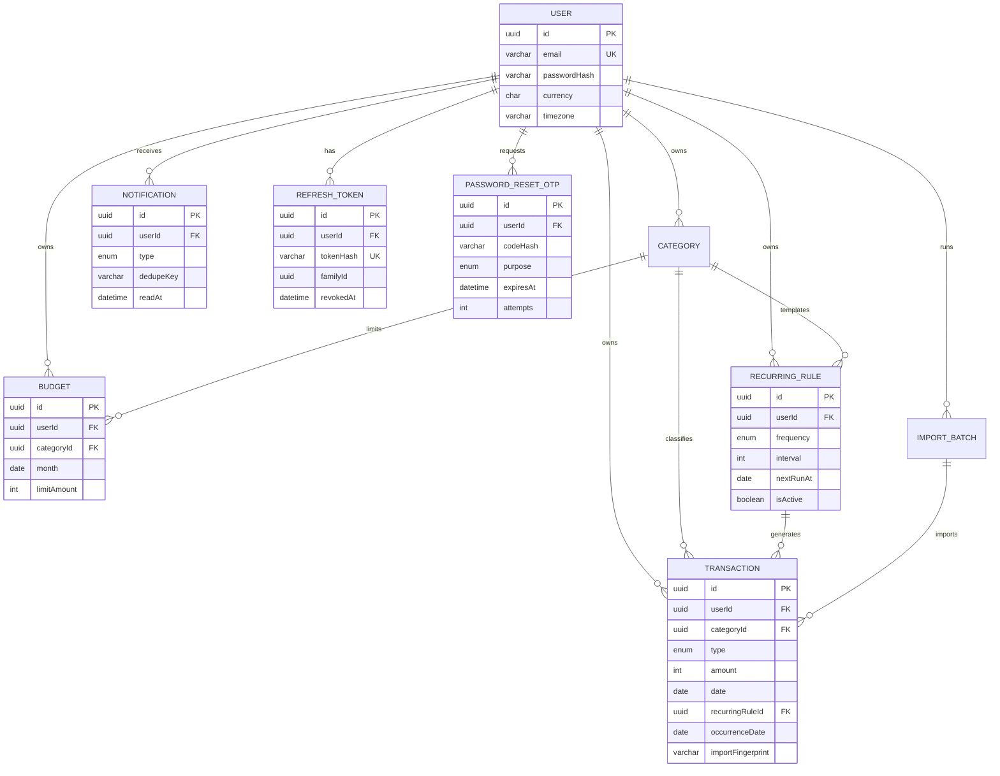

# SpendWell — Data Model

> Prisma schema, relations, enums, constraints, indexes, and the queries that justify them.
> Companion to `ARCHITECTURE.md` (decisions) and `API_SPEC.md` (transport shapes).

---

## 0. Assumptions

| # | Assumption | Impact |
|---|---|---|
| D1 | **All money is `Int` minor units** (paise/cents). `24900` = ₹249.00. Amounts are always **positive**; direction comes from `Transaction.type`. | Sign is never stored twice, so a negative amount cannot contradict `type`. Net = `SUM(income) - SUM(expense)` computed explicitly. |
| D2 | **One currency per user**, snapshotted onto each transaction. `User.currency` is immutable once transactions exist. | No FX table, no rounding between currencies. `currency` on `Transaction` exists so historical rows remain self-describing if the account currency is ever changed by a migration. |
| D3 | **`date` and `month` are calendar dates** (`@db.Date`), not instants. A transaction belongs to the local calendar day the user picked. | Month ranges are `[month, month + 1 month)` in SQL, with no timezone conversion. `createdAt` keeps the real instant. |
| D4 | **Users are soft-deleted nowhere except `Category.isArchived`.** Deleting a user cascades; deleting a category with references archives it. | History stays consistent; no `deletedAt` leaking into every query. |
| D5 | **Category type must match transaction type** (`INCOME` category only on `INCOME` transaction). | Enforced in the service layer; a composite FK is possible but adds complexity for little value at this scale. |
| D6 | **CSV duplicates are detected by a fingerprint** of `(date, type, amount, categoryId, normalized note)`, unique per user. Users can opt out per import with `allowDuplicates=true`. | Re-importing the same file is safe by default; two genuinely identical coffees on the same day need the opt-out. |
| D7 | **`ImportBatch` is added** to the eight requested models. | CSV import needs a durable audit trail and a place to store the row-level error report; without it, "which rows failed?" is unanswerable after the request ends. |
| D8 | **Identifiers are UUIDv4** (`@db.Uuid`). | Opaque, safe to expose, no enumeration. Cost is a larger index than `bigint`; acceptable at personal scale. |
| D9 | **Emails are normalized to lowercase in the service and uniqueness is enforced by the DB.** | Avoids `Foo@x.com` vs `foo@x.com` duplicate accounts without needing the `citext` extension. |

Currencies with a non-2 exponent (JPY = 0, KWD = 3) are supported by a small exponent map in `money.ts`; the schema itself does not care. **Never** hard-code `* 100` outside that helper.

---

## 1. Entity-relationship diagram



---

## 2. Prisma schema

```prisma
// apps/api/prisma/schema.prisma

generator client {
  provider = "prisma-client-js"
}

datasource db {
  provider = "postgresql"
  url      = env("DATABASE_URL")
}

// ─────────────────────────────── Enums ───────────────────────────────

enum TransactionType {
  INCOME
  EXPENSE
}

enum TransactionSource {
  MANUAL
  IMPORT
  RECURRING
}

enum Frequency {
  DAILY
  WEEKLY
  MONTHLY
  YEARLY
}

enum NotificationType {
  BUDGET_WARNING
  BUDGET_EXCEEDED
  RECURRING_POSTED
  SYSTEM
}

enum OtpPurpose {
  PASSWORD_RESET
  EMAIL_VERIFY
}

enum ImportStatus {
  PROCESSING
  COMPLETED
  FAILED
}

// ─────────────────────────────── User ────────────────────────────────

model User {
  id                    String    @id @default(uuid()) @db.Uuid
  email                 String    @unique @db.VarChar(320) // stored lowercase
  passwordHash          String    @db.VarChar(100)         // bcrypt output is 60 chars
  name                  String    @db.VarChar(80)
  currency              String    @default("INR") @db.Char(3)
  timezone              String    @default("Asia/Kolkata") @db.VarChar(64)
  avatarUrl             String?   @db.VarChar(512)
  emailVerifiedAt       DateTime?
  onboardingCompletedAt DateTime?
  lastLoginAt           DateTime?
  createdAt             DateTime  @default(now())
  updatedAt             DateTime  @updatedAt

  categories        Category[]
  transactions      Transaction[]
  budgets           Budget[]
  recurringRules    RecurringRule[]
  notifications     Notification[]
  refreshTokens     RefreshToken[]
  passwordResetOtps PasswordResetOtp[]
  importBatches     ImportBatch[]
}

// ────────────────────────────── Category ─────────────────────────────

model Category {
  id         String          @id @default(uuid()) @db.Uuid
  userId     String          @db.Uuid
  name       String          @db.VarChar(40)
  type       TransactionType
  icon       String          @default("tag") @db.VarChar(40)  // icon key from the design system
  color      String          @default("#6C5CE7") @db.Char(7)  // #RRGGBB
  isArchived Boolean         @default(false)
  createdAt  DateTime        @default(now())
  updatedAt  DateTime        @updatedAt

  user           User            @relation(fields: [userId], references: [id], onDelete: Cascade)
  transactions   Transaction[]
  budgets        Budget[]
  recurringRules RecurringRule[]

  // Category names are unique per user. The API also normalizes to Title Case;
  // a manual lower(name) unique index in the migration guards direct writes.
  @@unique([userId, name])
  @@index([userId, type, isArchived])
}

// ───────────────────────────── Transaction ───────────────────────────

model Transaction {
  id                String            @id @default(uuid()) @db.Uuid
  userId            String            @db.Uuid
  categoryId        String            @db.Uuid
  type              TransactionType
  source            TransactionSource @default(MANUAL)
  amount            Int               // minor units, > 0 (CHECK constraint)
  currency          String            @db.Char(3) // snapshot of User.currency
  date              DateTime          @db.Date     // calendar date chosen by the user
  note              String?           @db.VarChar(280)
  merchant          String?           @db.VarChar(80)

  // Traceability + idempotency for generated and imported rows
  recurringRuleId   String?           @db.Uuid
  occurrenceDate    DateTime?         @db.Date // the date this occurrence represents
  importBatchId     String?           @db.Uuid
  importFingerprint String?           @db.VarChar(64) // sha256 hex, set only for imports

  createdAt         DateTime          @default(now())
  updatedAt         DateTime          @updatedAt

  user          User           @relation(fields: [userId], references: [id], onDelete: Cascade)
  category      Category       @relation(fields: [categoryId], references: [id], onDelete: Restrict)
  recurringRule RecurringRule? @relation(fields: [recurringRuleId], references: [id], onDelete: SetNull)
  importBatch   ImportBatch?   @relation(fields: [importBatchId], references: [id], onDelete: SetNull)

  // Idempotency: one generated transaction per rule occurrence. PostgreSQL treats
  // NULLs as distinct, so manual rows (both columns NULL) are unaffected.
  @@unique([recurringRuleId, occurrenceDate], map: "transaction_recurring_occurrence_key")

  // Duplicate detection for CSV imports. NULL for non-import rows.
  @@unique([userId, importFingerprint], map: "transaction_import_fingerprint_key")

  // Primary list + trend access path: newest first, stable tiebreak on id.
  @@index([userId, date(sort: Desc), id(sort: Desc)])

  // Category filter + per-category spend aggregation in a date range.
  @@index([userId, categoryId, date(sort: Desc)])

  // Income vs expense totals and trend queries, which always constrain type.
  @@index([userId, type, date(sort: Desc)])

  @@index([importBatchId])
}

// ─────────────────────────────── Budget ──────────────────────────────

model Budget {
  id                String   @id @default(uuid()) @db.Uuid
  userId            String   @db.Uuid
  categoryId        String   @db.Uuid
  month             DateTime @db.Date // always the 1st of the month (CHECK constraint)
  limitAmount       Int      // minor units, > 0
  alertThresholdPct Int      @default(80) // 1..100, warn at this % of limit
  createdAt         DateTime @default(now())
  updatedAt         DateTime @updatedAt

  user     User     @relation(fields: [userId], references: [id], onDelete: Cascade)
  category Category @relation(fields: [categoryId], references: [id], onDelete: Restrict)

  // One budget per category per month. Also serves lookups by category.
  @@unique([userId, categoryId, month])
  // Month screen: all budgets for one user/month, ordered deterministically.
  @@index([userId, month])
}

// ─────────────────────────── RecurringRule ───────────────────────────

model RecurringRule {
  id         String          @id @default(uuid()) @db.Uuid
  userId     String          @db.Uuid
  categoryId String          @db.Uuid
  type       TransactionType
  amount     Int             // minor units, > 0
  note       String?         @db.VarChar(280)
  merchant   String?         @db.VarChar(80)

  frequency  Frequency
  interval   Int             @default(1) // every N periods, must be >= 1
  anchorDay  Int?            // 1..31, required for MONTHLY/YEARLY (clamping rule below)
  startDate  DateTime        @db.Date
  endDate    DateTime?       @db.Date
  nextRunAt  DateTime        @db.Date // next occurrence to materialize
  lastRunAt  DateTime?       @db.Date
  timezone   String          @db.VarChar(64) // snapshot at creation
  isActive   Boolean         @default(true)

  createdAt  DateTime        @default(now())
  updatedAt  DateTime        @updatedAt

  user         User          @relation(fields: [userId], references: [id], onDelete: Cascade)
  category     Category      @relation(fields: [categoryId], references: [id], onDelete: Restrict)
  transactions Transaction[]

  // Scheduler: "which active rules are due?" — the only hot query.
  @@index([isActive, nextRunAt])
  // Rule list on the "Recurring" settings screen.
  @@index([userId, isActive])
}

// ───────────────────────────── Notification ──────────────────────────

model Notification {
  id        String           @id @default(uuid()) @db.Uuid
  userId    String           @db.Uuid
  type      NotificationType
  title     String           @db.VarChar(120)
  body      String           @db.VarChar(500)
  data      Json?            // deep-link payload: { transactionId, budgetId, month }
  dedupeKey String           @db.VarChar(160) // e.g. budget:<id>:2026-11:80
  readAt    DateTime?
  createdAt DateTime         @default(now())

  user User @relation(fields: [userId], references: [id], onDelete: Cascade)

  // Makes alert generation idempotent: re-evaluating a budget cannot spam the user.
  @@unique([userId, dedupeKey])
  // List (newest first) and unread badge. A partial index for unread is added manually.
  @@index([userId, readAt, createdAt(sort: Desc)])
}

// ──────────────────────────── RefreshToken ───────────────────────────

model RefreshToken {
  id           String    @id @default(uuid()) @db.Uuid
  userId       String    @db.Uuid
  tokenHash    String    @unique @db.VarChar(64) // sha256(token) hex; never store the raw token
  familyId     String    @db.Uuid // shared by all descendants of one login
  expiresAt    DateTime
  revokedAt    DateTime?
  replacedById String?   @unique @db.Uuid
  userAgent    String?   @db.VarChar(255)
  ip           String?   @db.VarChar(45) // IPv6-safe
  createdAt    DateTime  @default(now())

  user       User          @relation(fields: [userId], references: [id], onDelete: Cascade)
  replacedBy RefreshToken? @relation("TokenRotation", fields: [replacedById], references: [id], onDelete: SetNull)
  replaces   RefreshToken? @relation("TokenRotation")

  @@index([userId, createdAt])
  @@index([familyId]) // reuse detection revokes a whole family
  @@index([expiresAt]) // cleanup job
}

// ────────────────────────── PasswordResetOtp ─────────────────────────

model PasswordResetOtp {
  id         String     @id @default(uuid()) @db.Uuid
  userId     String     @db.Uuid
  codeHash   String     @db.VarChar(100) // bcrypt, not sha256: the code space is only 10^6
  purpose    OtpPurpose @default(PASSWORD_RESET)
  expiresAt  DateTime
  consumedAt DateTime?
  attempts   Int        @default(0) // hard stop at 5
  createdAt  DateTime   @default(now())

  user User @relation(fields: [userId], references: [id], onDelete: Cascade)

  // "latest active OTP for this user + purpose" and resend cooldown checks.
  @@index([userId, purpose, createdAt(sort: Desc)])
  @@index([expiresAt]) // cleanup job
}

// ───────────────────────────── ImportBatch ───────────────────────────

model ImportBatch {
  id            String       @id @default(uuid()) @db.Uuid
  userId        String       @db.Uuid
  fileName      String       @db.VarChar(255)
  status        ImportStatus @default(PROCESSING)
  rowCount      Int          @default(0)
  importedCount Int          @default(0)
  skippedCount  Int          @default(0) // duplicates skipped
  failedCount   Int          @default(0) // row-level validation failures
  errorReport   Json?        // [{ row, code, message }] capped at 100 entries
  createdAt     DateTime     @default(now())
  completedAt   DateTime?

  user         User          @relation(fields: [userId], references: [id], onDelete: Cascade)
  transactions Transaction[]

  @@index([userId, createdAt(sort: Desc)])
}
```

---

## 3. Index rationale

Every user-owned query starts with `userId`. That is why **every composite index leads with `userId`**: the planner can use the leftmost prefix for the ownership predicate, and the remaining columns serve the filter/sort that follows. An index that does not lead with `userId` would be nearly useless in this schema and would add write cost for nothing.

| Index | Query it serves | Why this column order |
|---|---|---|
| `Transaction (userId, date DESC, id DESC)` | Transaction list, CSV export batches, "this month" totals, trend | `userId` equality → `date` range + descending order in one index scan; `id` makes ordering stable when two rows share a date (avoids duplicate/missing rows across pages). Satisfies the required `(userId, date)` index and is strictly better for the real sort. |
| `Transaction (userId, categoryId, date DESC)` | Filter list by category; spend-by-category in a date range; budget "spent" joins | Equality on `userId` + `categoryId`, then range/order on `date`. Satisfies the required `(userId, categoryId)` index. For `GROUP BY categoryId` over all categories, the `(userId, type, date)` index is often chosen instead. |
| `Transaction (userId, type, date DESC)` | Income vs expense totals, dashboard, trend | `type` is low cardinality (2 values) but the index lets Postgres read only the needed side of the ledger and keep rows ordered by date, avoiding a sort for the trend aggregation. |
| `Transaction unique (recurringRuleId, occurrenceDate)` | Idempotent recurring job | Partial-null composite: enforces "at most one transaction per rule per occurrence" at the database, which is the strongest guarantee available. NULLs are distinct in Postgres, so manual rows are unaffected. |
| `Transaction unique (userId, importFingerprint)` | CSV duplicate detection | Dedupe scope is per user, so the fingerprint alone must not collide across accounts. NULLs distinct keeps manual/recurring rows out of the constraint. |
| `Transaction (importBatchId)` | Batch rollback/report; FK maintenance | Small, cheap index for reverse lookup. The unique `(recurringRuleId, occurrenceDate)` index already covers rule history and the `SET NULL` check, so a separate `(recurringRuleId)` index would be redundant. |
| Trgm GIN on `note`, `merchant` (manual migration) | `q` search | `ILIKE '%term%'` cannot use a B-tree. `pg_trgm` turns it into a bitmap index scan. Cost: larger index and slower inserts; acceptable because search is far less frequent than writes. |
| `Category unique (userId, name)` + lower(name) unique | Category create/rename; duplicate guard | The composite unique is both a constraint and the lookup path for "does this user already have this category?". The lowercase functional index closes the `Food`/`food` hole. |
| `Category (userId, type, isArchived)` | Category picker (expense vs income, hide archived) | Small table; a single index covers the picker and keeps archived rows out of the hot path. |
| `Budget unique (userId, categoryId, month)` | Upsert/replace a budget; "is there a budget for this category this month?" | The uniqueness rule is also the primary access pattern. |
| `Budget (userId, month)` | Budget screen for a month | Equality/equality; the unique index cannot serve this because `categoryId` sits in the middle. |
| `RecurringRule (isActive, nextRunAt)` | Scheduler: due rules | `isActive=true` is a tiny slice; `nextRunAt` gives ordered range scans. Deliberately **not** led by `userId`, because the scheduler is a cross-user system query, not a user-owned read. |
| `RecurringRule (userId, isActive)` | User's recurring list | |
| `Notification unique (userId, dedupeKey)` | Idempotent alert writes | A `create` that hits this returns `P2002`, which the service treats as "already notified" instead of an error. |
| `Notification (userId, readAt, createdAt DESC)` | Notification list + unread filter | `readAt` equality (`NULL` for unread) then newest first. The manual partial index below is faster for the badge count. |
| `RefreshToken tokenHash unique` | Refresh flow lookup | O(1) by hash; the raw token never touches the DB. |
| `RefreshToken (familyId)`, `(userId, createdAt)`, `(expiresAt)` | Reuse revocation, session list, cleanup | Each serves one distinct operation; all are cheap because the table stays small (≈ active sessions per user). |
| `PasswordResetOtp (userId, purpose, createdAt DESC)` | Latest OTP, resend cooldown | Descending createdAt means `LIMIT 1` is an index-only read. |
| `PasswordResetOtp (expiresAt)` | Cleanup | |

**Indexes deliberately not added:** `Transaction(createdAt)` (never filtered on it), `Transaction(note)` alone (trgm covers search), `User(createdAt)` (no admin listing), and every foreign key in isolation (`categoryId` alone has low value because all queries include `userId`; `userId` alone is a prefix of four indexes already). Each unnecessary index slows every insert and update — on a write-heavy ledger that is a real cost.

### Manual SQL (not expressible in Prisma schema)

Add to the first migration, after `prisma migrate dev --create-only`:

```sql
CREATE EXTENSION IF NOT EXISTS pg_trgm;

-- Case-insensitive category uniqueness (names are also Title-Cased by the API).
CREATE UNIQUE INDEX category_user_lower_name_key
  ON "Category" ("userId", lower(name));

-- Search: substring match on note and merchant.
-- The query uses: (note ILIKE $q OR merchant ILIKE $q) AND "userId" = $1 ...
CREATE INDEX transaction_note_trgm_idx
  ON "Transaction" USING GIN (note gin_trgm_ops);
CREATE INDEX transaction_merchant_trgm_idx
  ON "Transaction" USING GIN (merchant gin_trgm_ops);

-- Unread badge: tiny partial index, avoids reading read notifications.
CREATE INDEX notification_unread_idx
  ON "Notification" ("userId", "createdAt" DESC)
  WHERE "readAt" IS NULL;

-- Invariants that Prisma cannot declare.
ALTER TABLE "Transaction"
  ADD CONSTRAINT transaction_amount_positive CHECK (amount > 0),
  ADD CONSTRAINT transaction_date_sane CHECK (date >= DATE '2000-01-01' AND date <= DATE '2100-01-01'),
  ADD CONSTRAINT transaction_recurring_pair CHECK (
    ("recurringRuleId" IS NULL AND "occurrenceDate" IS NULL)
    OR ("recurringRuleId" IS NOT NULL AND "occurrenceDate" IS NOT NULL)
  );

ALTER TABLE "Budget"
  ADD CONSTRAINT budget_limit_positive CHECK ("limitAmount" > 0),
  ADD CONSTRAINT budget_threshold_range CHECK ("alertThresholdPct" BETWEEN 1 AND 100),
  ADD CONSTRAINT budget_month_first_day CHECK (EXTRACT(DAY FROM month) = 1);

ALTER TABLE "RecurringRule"
  ADD CONSTRAINT recurring_amount_positive CHECK (amount > 0),
  ADD CONSTRAINT recurring_interval_positive CHECK (interval >= 1),
  ADD CONSTRAINT recurring_anchor_day_range CHECK ("anchorDay" IS NULL OR "anchorDay" BETWEEN 1 AND 31);

ALTER TABLE "Notification"
  ADD CONSTRAINT notification_dedupe_key_present CHECK (length("dedupeKey") > 0);
```

`CHECK` constraints are the last line of defense. Service validation produces friendly errors; the database guarantees that a future bug, script, or manual `psql` session cannot insert a negative expense or a mid-month budget.

---

## 4. Invariants and how they are enforced

| Invariant | Enforced by | Error surfaced |
|---|---|---|
| Amount is a positive integer in minor units | Zod (`int().positive()`), `CHECK (amount > 0)` | `VALIDATION_ERROR` / 400 |
| Expense vs income sign | `type` enum only; no negative amounts | — |
| Transaction category belongs to the same user | `categoryRepo.findOwned(userId, categoryId)` before write | `CATEGORY_NOT_FOUND` / 404 |
| Category type matches transaction type | Service check | `CATEGORY_TYPE_MISMATCH` / 422 |
| One budget per category per month | `@@unique([userId, categoryId, month])` | `BUDGET_EXISTS` / 409 |
| Budget month is the 1st | Zod regex + DB `CHECK` | `VALIDATION_ERROR` / 400 |
| One generated transaction per rule occurrence | `@@unique([recurringRuleId, occurrenceDate])` | Job treats `P2002` as success |
| No duplicate imported row (opt-out available) | `@@unique([userId, importFingerprint])` | Import summary `skippedCount++` |
| Only one live alert per budget/threshold/month | `@@unique([userId, dedupeKey])` on Notification | `P2002` ignored by alert service |
| Refresh token is single-use | `revokedAt` set inside the rotation transaction | `REFRESH_TOKEN_REUSED` / 401 |
| OTP is single-use, 5 attempts max | `consumedAt`, `attempts` updated atomically | `OTP_INVALID` / `OTP_LOCKED` |
| Currency cannot change after history exists | Service counts transactions before allowing update | `CURRENCY_LOCKED` / 409 |
| Cross-user access is invisible | Repository `where { id, userId }`; 404 | `NOT_FOUND` / 404 |
| Deletes do not orphan transactions | `Category.onDelete: Restrict` + archive rule | `CATEGORY_IN_USE` / 409 (or archive) |

### Date and recurrence semantics (the subtle part)

- **Monthly rules** keep `anchorDay` from `startDate` (e.g. 31). Occurrences are clamped to the last day of shorter months: Jan 31 → Feb 28 → **Mar 31** (not Mar 28). The clamp is computed from the anchor, not from the previous run, which is the bug most naive implementations ship.
- **Weekly rules** anchor on the weekday of `startDate`; **yearly** on month/day with Feb 29 → Feb 28 in non-leap years.
- **`nextRunAt` is a date**, evaluated in the rule's stored `timezone`. The job runs every 15 minutes; it gets "today" per rule timezone and processes `nextRunAt <= today`. This makes the job tolerant of DST and of a missed run.
- **Catch-up is bounded** to `RECURRING_CATCHUP_DAYS` (60). A rule overdue by a year does not silently create 365 transactions.
- **Editing a rule** only affects future occurrences (`nextRunAt` onward). Already-generated transactions are not rewritten — they are history, and the unique key would fight the update anyway.
- **Deleting a rule** sets `isActive=false` (soft stop) and keeps prior transactions; a hard delete would null their `recurringRuleId` and lose traceability.

---

## 5. The queries that matter

All amounts below are integer minor units. All user queries take `userId` as `$1`. Date ranges are **half-open** `[from, toExclusive)`; the API converts an inclusive `to=2026-11-30` into `toExclusive = 2026-12-01`.

### 5.1 Monthly summary (dashboard)

```sql
SELECT
  COALESCE(SUM(amount) FILTER (WHERE type = 'INCOME'),  0)::bigint AS income,
  COALESCE(SUM(amount) FILTER (WHERE type = 'EXPENSE'), 0)::bigint AS expense,
  COUNT(*)::int                                                   AS transaction_count
FROM "Transaction"
WHERE "userId" = $1
  AND date >= $2          -- 2026-11-01
  AND date <  $3;         -- 2026-12-01
```

Uses `(userId, date DESC, id DESC)` for the range (backward index scan is fine) or `(userId, type, date)` for the filtered sums. One round trip, no N+1.

### 5.2 Spend by category (donut chart + list)

```sql
SELECT
  c.id,
  c.name,
  c.color,
  c.icon,
  SUM(t.amount)::bigint AS total,
  COUNT(*)::int         AS transaction_count
FROM "Transaction" t
JOIN "Category" c ON c.id = t."categoryId"
WHERE t."userId" = $1
  AND t.type = 'EXPENSE'
  AND t.date >= $2
  AND t.date <  $3
GROUP BY c.id, c.name, c.color, c.icon
ORDER BY total DESC, c.name ASC;
```

The API computes `sharePct` from the same rows (`total * 10000 / grandTotal` basis points, then formats) so the chart and the list can never disagree.

### 5.3 Income vs expense trend (Recharts line/area)

```sql
WITH periods AS (
  SELECT generate_series($2::date, $3::date, interval '1 month')::date AS period_start
),
agg AS (
  SELECT
    date_trunc('month', date)::date AS period_start,
    SUM(amount) FILTER (WHERE type = 'INCOME')  AS income,
    SUM(amount) FILTER (WHERE type = 'EXPENSE') AS expense
  FROM "Transaction"
  WHERE "userId" = $1
    AND date >= $2
    AND date <  $4
  GROUP BY 1
)
SELECT
  p.period_start,
  COALESCE(a.income,  0)::bigint AS income,
  COALESCE(a.expense, 0)::bigint AS expense,
  (COALESCE(a.income, 0) - COALESCE(a.expense, 0))::bigint AS net
FROM periods p
LEFT JOIN agg a USING (period_start)
ORDER BY p.period_start;
```

`generate_series` guarantees **zero-filled buckets**. Without it, a month with no transactions silently disappears from the chart and the line jumps across a gap — a classic analytics bug.

### 5.4 Budget status for a month

```sql
SELECT
  b.id,
  b."categoryId",
  b."limitAmount",
  b."alertThresholdPct",
  COALESCE(SUM(t.amount), 0)::bigint AS spent
FROM "Budget" b
LEFT JOIN "Transaction" t
  ON t."userId"     = b."userId"
 AND t."categoryId" = b."categoryId"
 AND t.type         = 'EXPENSE'
 AND t.date        >= b.month
 AND t.date        <  (b.month + interval '1 month')::date
WHERE b."userId" = $1
  AND b.month    = $2
GROUP BY b.id
ORDER BY b.id;
```

Computed `remaining = limitAmount - spent` and status:

- `OK` when `spent * 100 < limitAmount * thresholdPct`
- `WARNING` when `spent >= limitAmount * thresholdPct / 100` and `spent <= limitAmount`
- `EXCEEDED` when `spent > limitAmount`

All comparisons use integer cross-multiplication (`spent * 100 >= limitAmount * threshold`), never `spent / limitAmount` float division.

### 5.5 Unread badge

```sql
SELECT COUNT(*)::int
FROM "Notification"
WHERE "userId" = $1 AND "readAt" IS NULL;
```

Served entirely by the partial index; stays fast even at thousands of notifications.

### 5.6 Due recurring rules

```sql
SELECT *
FROM "RecurringRule"
WHERE "isActive" = true
  AND "nextRunAt" <= $1
ORDER BY "nextRunAt" ASC
LIMIT 500
FOR UPDATE SKIP LOCKED;
```

`FOR UPDATE SKIP LOCKED` lets a second worker (or a second API instance that somehow acquired the lock late) take different rules instead of blocking or double-processing. The unique key is still the final guarantee.

---

## 6. BigInt and serialization

`SUM(int)` in PostgreSQL returns `bigint`. Prisma raw queries surface that as JavaScript `BigInt`, which `JSON.stringify` cannot serialize.

Rules:

1. Money sums are converted in a single helper: `toMinorNumber(value: bigint): number` — throws if `|value| > Number.MAX_SAFE_INTEGER` (≈ 9.0 × 10¹⁵ minor units, far beyond any personal ledger).
2. DTOs expose `amount: number` (minor units) plus the currency once. No decimal strings in JSON.
3. CSV export formats with the currency exponent using string math (`integerPart` / `fractionPart`), never `amount / 100`.

---

## 7. Seed data (`prisma/seed.ts`)

Deterministic and safe to re-run (upsert by email/category name).

- Demo user: `demo@spendwell.app` / `Demo@12345`, timezone `Asia/Kolkata`, currency `INR`.
- 11 default categories, created for **every** new user inside the registration transaction (this is why a fresh account is usable immediately):
  - Expense: Food & Dining, Transport, Shopping, Bills & Utilities, Entertainment, Health, Education, Rent, Other.
  - Income: Salary, Freelance.
  - Colors and icon keys match the design tokens.
- 120 transactions spread across the last 3 months, with a realistic mix (~70% expense), some merchants and notes, deterministic randomness from a fixed seed.
- 4 budgets for the current month at different thresholds (one near warning, one exceeded) so the dashboard, analytics, and notification states are all visible without manual setup.
- 5 notifications (2 unread), 2 recurring rules (one monthly rent, one weekly subscription).
- An `ImportBatch` + 10 imported transactions to exercise the CSV report UI.

Seed is **development only**; it refuses to run when `NODE_ENV=production` unless `ALLOW_PROD_SEED=true`.

---

## 8. Retention and deletion

| Data | Retention | Mechanism |
|---|---|---|
| Transactions / budgets / rules | Until the user deletes them or the account | Hard delete; cascade on user delete |
| Notifications | 180 days | `cleanup.job` batched delete |
| Refresh tokens | 30 days after expiry/revocation | `cleanup.job` |
| OTPs | 24 hours after expiry/consumption | `cleanup.job` |
| Import batches | 90 days (transactions remain; `importBatchId` → `SET NULL`) | `cleanup.job` |
| Backups | 14 days (managed Postgres PITR window) | Provider policy, documented in README |

Account deletion is a hard delete of `User`; every relation cascades except `Category` → `Transaction`, which is `Restrict`. The delete therefore runs inside a transaction that first deletes the user's transactions, then categories, then the user — the service owns the order, and the DB prevents an accidental partial delete.

---

## 9. Migration workflow

1. Edit `schema.prisma`.
2. `pnpm prisma migrate dev --create-only --name <change>` — generates SQL **without** applying it.
3. Hand-edit the SQL: add the extension, functional/partial/trgm indexes, and `CHECK` constraints from §3. Review `DROP` statements; Prisma sometimes drops and recreates indexes.
4. `pnpm prisma migrate dev` locally; run the integration suite.
5. CI runs `prisma migrate deploy` against a fresh Postgres on every PR (proves migrations replay from zero).
6. Production releases are **expand → deploy → contract**: add nullable columns/tables first, deploy code that writes both shapes, backfill, then remove the old shape in a later release. No destructive migration in the same deploy as the code that depends on it.

`prisma migrate reset` is allowed only locally. It is wired to a script that refuses when `DATABASE_URL` does not point at `localhost`.
