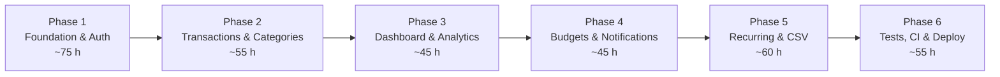

# SpendWell — Roadmap

> A phased build plan for **one developer**. Every task is small enough to finish in a sitting and has a testable acceptance criterion.
> Estimate basis: **≈ 335 focused hours** (+ buffer). Two honest tracks: **25 h/week → 15 weeks**, or **15 h/week → 22–24 weeks**. Compress the calendar if you have more time, never the phase gates.

---

## 0. Assumptions and planning rules

| # | Assumption |
|---|---|
| R1 | The Figma "Penny Tracker" file covers the 16 listed screens. **Recurring rules and CSV import/export have no dedicated screen in that list**; they get minimal entry points (Profile → Recurring, Transactions → overflow → Import/Export) with simple states. Designer input is required before Phase 5 UI work. |
| R2 | Auth OTP delivery uses a console driver in development and a transactional email provider in production. No SMS. |
| R3 | One environment for staging and one for production; both use managed Postgres. Local uses Docker Compose. |
| R4 | No feature work starts before its phase gate passes. A half-finished phase is worse than a smaller finished one. |
| R5 | "Done" always means: code + types + tests + error codes + docs updated. Not "works on my machine". |

### Definition of Done (applies to every task)

- [ ] Types compile with `strict: true`; no `any` added without a comment explaining why.
- [ ] Unit or integration tests cover the happy path **and** the main failure path.
- [ ] New endpoints: success, validation failure, unauthenticated, cross-user 404.
- [ ] Errors use the closed catalog in `API_SPEC.md`; no ad-hoc strings.
- [ ] No secrets, `console.log`, or TODOs left in the diff.
- [ ] `pnpm lint && pnpm typecheck && pnpm test` pass locally.
- [ ] The relevant doc (`API_SPEC`, `DATA_MODEL`, `ARCHITECTURE`) matches the code.

### Sizes

`S` ≈ 2–3 h · `M` ≈ 4–6 h · `L` ≈ 8–10 h. A task larger than `L` is split. Estimates assume you have already used the stack once; if not, add 30% in Phase 1 and 2.

---

## 1. Phase overview

| Phase | Weeks (25 h/wk) | Demoable outcome | Resume checkpoint |
|---|---|---|---|
| 1 | 1–3 | Sign up, log in, refresh silently, reset password by OTP, edit profile | "JWT access + refresh rotation with reuse detection" |
| 2 | 4–6 | Full transaction ledger with search, filters, pagination, categories | "Type-safe REST API with per-user scoping and indexed queries" |
| 3 | 7–8 | Dashboard and analytics charts with real aggregates | "SQL aggregation and charting over a normalized Postgres schema" |
| 4 | 9–10 | Monthly budgets with progress and in-app alerts | "Event-driven budget alerting with idempotent notifications" |
| 5 | 11–13 | Recurring transactions + CSV import/export | "Idempotent scheduled jobs and validated bulk import" |
| 6 | 14–15 | CI/CD, deployed app, measured performance numbers | "Docker + GitHub Actions pipeline with measured p95 latency" |

---

## 2. Phase 1 — Foundation and auth (~75 h)

**Goal:** a deployable skeleton with a complete, tested authentication lifecycle and a real database schema.
**Demo:** fresh clone → `docker compose up` → register → reload (session restored) → log out → forgot password → OTP → new password → log in.

### Tasks

| ID | Task | Size | Acceptance criteria |
|---|---|---|---|
| 1.1 | **Monorepo scaffold.** pnpm workspaces, `apps/web`, `apps/api`, `packages/shared`, shared `tsconfig.base.json`, ESLint + Prettier, root scripts (`dev`, `build`, `lint`, `typecheck`, `test`). | M | `pnpm install` from a clean clone succeeds; `pnpm build` builds shared → api → web; `pnpm lint` and `pnpm typecheck` pass with zero warnings. |
| 1.2 | **Web scaffold.** Vite + React + TS + Tailwind + React Router + TanStack Query; `QueryClient` defaults (no retry on 4xx, 1 retry on 5xx GET); base layout and 404 route. | S | `pnpm dev` serves the app; Tailwind classes compile; an unknown URL renders the 404 page, not a blank screen. |
| 1.3 | **API scaffold.** Express 5 app factory (`app.ts`) separate from `server.ts`; Zod-parsed env that exits on invalid config; `requestId`, `helmet`, CORS allowlist, JSON limit, `notFound`, `errorHandler`; `/healthz`. | M | Booting with a missing `DATABASE_URL` prints a readable error and exits non-zero; every response has `X-Request-Id`; an unknown route returns the documented 404 envelope. |
| 1.4 | **Local infrastructure.** `docker-compose.yml` with Postgres 16 (+ healthcheck); `.env.example` for both apps; README quick start; `.gitignore` covers `.env`, `node_modules`, `dist`. | S | `docker compose up -d` then `pnpm dev` works on a machine that has only Docker + Node; README commands are copy-paste correct. |
| 1.5 | **Prisma schema + migration.** All models/enums from `DATA_MODEL.md`; hand-edited migration with `pg_trgm`, trgm/full/partial indexes, and `CHECK` constraints; `seed.ts`. | L | `prisma migrate reset && prisma db seed` completes twice in a row; `psql \d "Transaction"` shows the expected indexes and checks; inserting a negative amount fails at the DB. |
| 1.6 | **Auth primitives.** bcrypt wrapper, JWT sign/verify with `typ`/`aud`, refresh-token generation + SHA-256 hash, cookie helpers, OTP generator, `AppError` + error catalog. | M | Unit tests cover: expired token rejected, wrong audience rejected, bcrypt verify, OTP is 6 digits and hashed, cookie options match env. |
| 1.7 | **Register / login / refresh / logout / logout-all.** Token rotation + family reuse detection; default categories seeded in the registration transaction. | L | Integration tests: register 201 + cookie; duplicate email 409; login wrong password 401 with identical body to unknown email; refresh rotates; reusing the old refresh token returns 401 `REFRESH_TOKEN_REUSED` and revokes the family; logout is idempotent. |
| 1.8 | **Forgot password → OTP → reset.** Mail adapter (console driver), OTP bcrypt hash, 10 min TTL, 5 attempts, 60 s cooldown, reset JWT (`purpose: pwd_reset`, `jti` = OTP id), revoke all sessions on success. | L | Tests: unknown email still 202; 6th attempt returns `OTP_LOCKED`; expired OTP returns `OTP_EXPIRED`; reused reset token fails; after reset the old refresh cookie is rejected; new password logs in. |
| 1.9 | **Auth UI.** Login, sign up, forgot, OTP (6 boxes, paste support, countdown), new password. Shared Zod schemas, inline field errors, API error mapping by `code`. | L | Full flow works on a 375 px viewport; wrong OTP shows the server message without losing the entered email; submit is disabled while pending; no token in `localStorage`. |
| 1.10 | **Session plumbing.** In-memory access token, `apiClient` with single-flight refresh and one retry, `AuthProvider`, `ProtectedRoute`, boot gate for splash (not a route), redirect rules. | L | Two simultaneous 401s trigger exactly one `POST /auth/refresh` (assert in network log); reload restores the session from the cookie; visiting `/app/*` while signed out redirects to `/login` and returns after login. |
| 1.11 | **Profile + onboarding.** `GET/PATCH /users/me`, password change, onboarding-complete; profile and edit-profile screens; landing page shell. | M | Currency cannot change once a transaction exists (test); timezone validated; onboarding flag persists; changing the password keeps the current session and revokes others. |
| 1.12 | **Phase gate.** CI workflow skeleton (install → lint → typecheck → test with Postgres service → build). | M | CI is green on a PR; all Phase 1 integration tests run against a real Postgres; a manual scripted walkthrough of every auth screen passes. |

### Exit criteria

- [ ] Zero `any` in `apps/api/src` outside explicitly justified spots.
- [ ] Every auth error in the catalog has a test.
- [ ] Refresh reuse is proven by a test, not by reading the code.
- [ ] `docker compose up` on a clean machine reaches a working login screen.
- [ ] No secret appears in any committed file (`git grep` for the secret values).

**Watch out:** the refresh cookie's `Secure` flag breaks localhost HTTP if set in development. Drive it from `COOKIE_SECURE` and document that `SameSite=None` requires HTTPS. Also: `Path=/api/v1/auth` means the cookie is **not** sent to `/users/me` — that is intended (only `/auth/refresh` and `/auth/logout` need it).

---

## 3. Phase 2 — Transactions and categories (~55 h)

**Goal:** the core ledger. Create, read, update, delete, filter, search, paginate — all correctly scoped.
**Demo:** 120 seeded transactions; search "swiggy"; filter by category and date; page through; add one; edit it; delete it; the summary header updates.

### Tasks

| ID | Task | Size | Acceptance criteria |
|---|---|---|---|
| 2.1 | **Category module.** Repo + service + routes; case-insensitive uniqueness; type immutable; archive/delete rules; `GET /categories` paginated. | M | Tests: duplicate name (including `food` vs `Food`) → 409; type change → 422; deleting a used category archives it and keeps its transactions; deleting an unused one removes it; every query is user-scoped. |
| 2.2 | **Category UI.** Picker (grouped income/expense, icons, colors), manage screen (rename, recolor, archive), empty state. | M | Picker loads within one request (`pageSize=100`); archived categories are hidden by default; rename reflects in the transaction list without a full reload (query invalidation). |
| 2.3 | **Transaction write path.** `POST/PATCH/DELETE`, ownership checks, category-type match, currency snapshot, date bounds, note/merchant limits. | L | Tests: cross-user category → 404; income category on expense → 422; currency sent by client is ignored; future date beyond +1 day → 400; delete is 204 and gone on re-read. |
| 2.4 | **Transaction read path.** List with `page/pageSize`, `q`, `type`, `categoryId`, `from/to`, `min/maxAmount`, allow-listed sort, `meta.summary`; `GET /:id`. | L | Search escapes `%`/`_`; date range is inclusive at both ends; `page` beyond the last returns `data: []` with correct totals; summary matches the filtered set; `EXPLAIN` shows an index scan, not a sequential scan, at 10 k rows. |
| 2.5 | **Transaction list UI.** Date-grouped list, sticky month header, filter sheet (type, category, date range, amount), search with debounce (300 ms), pagination/infinite scroll, skeletons, empty and error states. | L | Typing in search issues one request per pause, not per keystroke; clearing filters restores the full list; the URL reflects filters so refresh/back preserves them. |
| 2.6 | **Add/edit form.** Type toggle, amount input that accepts `1,234.50` and submits integer minor units, category picker, date (default today in user timezone), note, merchant. | L | `249.5` → `24950`; `0.005` is rejected; `abc` is rejected; the submit button is disabled while pending; editing a recurring-generated transaction works but shows its source. |
| 2.7 | **Delete UX.** Confirmation dialog, optimistic removal with rollback on error, toast. | S | A failed delete restores the row and shows the server error; deleting the last row on a page falls back to the previous page. |
| 2.8 | **Data + performance sanity.** Seed 120 transactions across 3 months; add a script to seed 10 k rows for a load user. | S | List API p95 < 150 ms for 10 k rows/user locally; search < 200 ms; summary query < 100 ms (recorded in the README bench table). |
| 2.9 | **Phase gate.** Every Phase 2 endpoint has the four required tests; the list is verified user-scoped with a second account. | M | Attempting to read another user's transaction by id returns 404; CI green; demo script passes. |

### Exit criteria

- [ ] A second user cannot see, edit, or delete the first user's data (tested, not assumed).
- [ ] Amount parsing never uses `parseFloat`.
- [ ] List queries are index-backed and the plan is recorded.
- [ ] The UI is usable one-handed at 375 px with no horizontal scroll.

---

## 4. Phase 3 — Dashboard and analytics (~45 h)

**Goal:** turn stored rows into insight, using SQL aggregation rather than client-side summing.
**Demo:** dashboard totals for November; donut by category; 6-month income vs expense trend; month switcher.

### Tasks

| ID | Task | Size | Acceptance criteria |
|---|---|---|---|
| 3.1 | **Analytics service: summary.** Monthly totals, previous-period comparison, avg daily spend, top category, transaction count. | M | Hand-computed fixture totals match exactly (integer paise); a month with no data returns zeros, not 404; previous-period comparison is null-safe when the previous value is 0. |
| 3.2 | **By-category + trend.** `GROUP BY` query; `generate_series` zero-fill; granularity caps; pagination for by-category. | L | A month without transactions appears as a zero bucket; caps return 422 `RANGE_TOO_LARGE`; `share` sums to ~100 ± rounding; pagination totals equal the category count. |
| 3.3 | **Dashboard UI.** Balance card, income/expense chips, budget snapshot, recent 5 transactions, month selector, skeletons, empty state for new users. | L | First meaningful paint < 2 s on a throttled 4G profile; no layout shift when data arrives; a new user sees a guided empty state, not `₹0` cards with no explanation. |
| 3.4 | **Analytics UI.** Donut (category), area/line (trend), range selector (week/month/6M), legend, tooltips formatted in the user's currency, "Other" slice. | L | Recharts is lazy-loaded (main bundle does not grow by ~100 kB); charts render with one data point without crashing; tooltips use minor-unit → major formatting; reduced-motion disables animations. |
| 3.5 | **Cache and invalidation.** Query keys per (endpoint, filters); mutations invalidate dashboard, analytics, budgets, notifications. | M | Adding a transaction updates dashboard and analytics without a manual refresh; switching months uses cached data when revisiting and shows a subtle loading state otherwise. |
| 3.6 | **Performance record.** `EXPLAIN (ANALYZE, BUFFERS)` for the three analytics queries at 100 k rows/user; record timings before/after indexes. | M | A markdown bench table in the README shows query text, plan node, rows scanned, and p50/p95 over 50 runs. |
| 3.7 | **Phase gate.** All analytics endpoints tested with seeded fixtures; no client-side aggregation left. | S | Search the web codebase for `reduce(` over transactions — there should be none for totals. CI green. |

### Exit criteria

- [ ] Every displayed total comes from the API, not from summing the current page.
- [ ] Month boundaries are correct for a user in `Asia/Kolkata` at 00:30 on the 1st.
- [ ] Charts have loading, empty, error, and single-point states.
- [ ] The three analytics queries have recorded plans and timings.

---

## 5. Phase 4 — Budgets and notifications (~45 h)

**Goal:** budgets with real spend, and alerts that fire once and are explainable.
**Demo:** set a ₹8,000 food budget with an 80% threshold; add expenses; get "80% used"; cross the limit; get "exceeded"; see both in the inbox; mark read; badge disappears.

### Tasks

| ID | Task | Size | Acceptance criteria |
|---|---|---|---|
| 4.1 | **Budget module.** CRUD, unique per `(category, month)`, computed `spent/remaining/percentUsed/status`, month filter, summary. | L | `spent` only counts EXPENSE transactions in that month/category; status boundaries are exact (spent == limit is `WARNING`, not `EXCEEDED`); creating a duplicate returns 409; income category rejected. |
| 4.2 | **Budget UI.** Month view with progress bars, remaining amount, threshold marker, set/edit sheet (amount keypad), empty state, over-budget styling. | L | Progress colour matches the three statuses; editing a limit updates `remaining` immediately after invalidation; a 0-limit is impossible; amounts display in the user's currency. |
| 4.3 | **Budget alert evaluation.** After transaction create/update/delete, compute month spend and upsert notifications at warning and exceeded thresholds, with dedupe keys. | L | Repeated writes at the same threshold produce exactly one notification; crossing warning then limit produces exactly two; lowering a budget below current spend triggers the appropriate alert; a failed alert never fails the transaction (simulate mail/notification error). |
| 4.4 | **Notification module.** Paginated list, unread count, mark one/all read, delete; deep-link `data` payload. | M | Unread count uses the partial index; mark-read is idempotent; a deleted category does not break old notification rendering (title/body are stored snapshots). |
| 4.5 | **Notification UI.** Inbox grouped by day, unread dots, badge on the tab bar, tap → relevant screen, mark-all-read, empty state. | M | Badge updates without a page reload (invalidate on mutation); tapping a budget alert opens the correct month; read state survives refresh. |
| 4.6 | **Edge cases.** Month rollover, editing a transaction across months, deleting a transaction below threshold, archived category with an existing budget. | M | Regression tests for each case; alerts are never duplicated; deleting a transaction does not delete historical alerts (documented behavior). |
| 4.7 | **Phase gate.** Alert rules documented as a truth table in the README; all four status/threshold combinations tested. | S | A reviewer can predict exactly when an alert fires from the documentation alone. CI green. |

### Exit criteria

- [ ] Alert generation is idempotent under repeated writes (tested).
- [ ] The notification list never leaks another user's rows.
- [ ] Budget math is integer-only; no float comparison at a threshold.
- [ ] Every budget/notification state in the UI has a design or an approved default (Designer sign-off).

---

## 6. Phase 5 — Recurring transactions and CSV (~60 h)

**Goal:** automatic recurring entries that never double-post, and CSV import/export that is safe to retry.
**Demo:** create a monthly rent rule on the 31st; job posts it; run the job twice → one transaction; import the same CSV twice → second time reports duplicates; export the ledger and re-import it.

### Tasks

| ID | Task | Size | Acceptance criteria |
|---|---|---|---|
| 5.1 | **Recurrence engine.** Pure date functions for DAILY/WEEKLY/MONTHLY/YEARLY with `interval`, `anchorDay`, month-end clamping, leap years, timezone-aware "today". | L | Unit tests: Jan 31 monthly → Feb 28/29 → **Mar 31**; Feb 29 yearly → Feb 28; interval 2 skips correctly; endDate stops; 30 tests from a table of cases, all no-DB and < 1 s. |
| 5.2 | **Recurring rule CRUD.** Create/list/update/pause/delete; validation that the category type matches; `nextRunAt` initialization. | M | Creating a rule does not immediately create a transaction unless `startDate <= today`; pausing stops future posts but keeps history; deleting sets inactive and keeps transactions. |
| 5.3 | **Scheduler job.** `node-cron` every 15 min; advisory lock; due-rule query with `FOR UPDATE SKIP LOCKED`; per-rule transaction insert; advance `nextRunAt`; bounded catch-up; `RECURRING_POSTED` notification. | L | Running the job twice on the same day creates one transaction (unique key); two concurrent job processes create one (advisory lock + unique key); a rule overdue by 90 days posts only the last 60 days and logs the gap; a job failure rolls back that rule only, not the whole batch. |
| 5.4 | **Recurring UI.** List with next date and amount, pause/resume, edit, delete; entry point from Profile. | M | The next date is shown in the user's timezone; toggling pause updates the badge; no screen requires the user to understand cron syntax. |
| 5.5 | **CSV export.** Streamed rows, keyset batching, RFC 4180 quoting, BOM, correct currency exponent, filters, 100 k cap. | M | Exporting 50 k rows uses < 100 MB RSS; Excel opens the file with correct columns; a note containing a comma, quote, and newline round-trips exactly. |
| 5.6 | **CSV import.** Multipart upload, size/row caps, Papa Parse, per-row validation, category resolution/creation, fingerprint dedupe, chunked insert in one transaction, ImportBatch report, dry run. | L | Re-importing the same file yields `imported: 0, skippedDuplicates: N`; a row with `1,234.50` is rejected with a row number; 4 999 rows import under 5 s locally; a failure mid-file writes nothing. |
| 5.7 | **Import/export UI.** File picker, template download, preview (dry run) with error table, confirm import, result summary; entry in the Transactions overflow menu. | L | The user sees row-level errors before committing; cancel writes nothing; the summary distinguishes imported / duplicates / failed; the list refreshes after import. |
| 5.8 | **Idempotency drill.** Script: start job, kill the API mid-run, restart, run again; import the same file 3×. Ship it as `pnpm drill:recurring --processes 5 --rules 200`, `pnpm drill:recurring --kill 20`, and `pnpm drill:import-dup`. | M | Drill output committed to `docs/bench/` shows zero duplicates and a clear recovery log; this is the evidence for the resume claim. |
| 5.9 | **Phase gate.** Recurrence unit suite + integration drill green; CSV round-trip test (export → import into a fresh account) matches totals exactly. | S | Round-trip fixture: 200 transactions, totals equal to the paise. CI green. |

### Exit criteria

- [ ] No duplicate recurring transaction under any restart/concurrency scenario tested.
- [ ] No partial CSV import is ever visible.
- [ ] Import errors are actionable (row number, column, reason).
- [ ] Designer has approved the two new entry points and their states.

---

## 7. Phase 6 — Tests, CI, and deploy (~55 h)

**Goal:** prove it works without a human clicking, ship it, and measure it.
**Demo:** PR → green pipeline → merge → automatic migrate + deploy → smoke test → live URL; benchmark table in the README.

### Tasks

| ID | Task | Size | Acceptance criteria |
|---|---|---|---|
| 6.1 | **Test hardening.** Coverage gate (70% lines on `services/` + `lib/`); cross-user matrix for every resource; error-code coverage test; flaky-test sweep. | L | `pnpm test:coverage` fails below threshold; each endpoint has success/validation/401/cross-user tests; the suite runs in < 90 s. |
| 6.2 | **CI pipeline.** pnpm cache, Postgres service, `migrate deploy`, lint, typecheck, test, build, Docker build; artifacts for coverage and web bundle. | M | A deliberately broken test fails CI; a PR from a fork still runs (no secrets needed); total runtime < 8 min. |
| 6.3 | **CD pipeline.** Build/push image to GHCR, migration release step, deploy API, deploy static web, smoke test `/healthz` and `/readyz`; rollback documented. | L | Merge to `main` reaches production with zero manual steps; a failing smoke test marks the deploy failed; rollback to the previous image is tested once. |
| 6.4 | **Observability.** pino JSON logs with redaction, requestId correlation, error-level alerts, uptime check, optional Sentry for web+api. | M | A forced 500 can be traced from the browser `requestId` to a single server log line; no password/token/cookie appears in logs (grep the log sample). |
| 6.5 | **Security checklist.** Helmet, CORS, cookie flags, rate limits, bcrypt cost, dependency audit, `npm audit`/`pnpm audit`, secrets scan. | M | Checklist committed with evidence; rate limits verified by a script that trips them; no high/critical audit findings unresolved. |
| 6.6 | **Benchmarks.** Seed 100 k transactions for one user; ship `pnpm bench:api`, `pnpm bench:import`, and `pnpm bench:export`; record p50/p95/p99 and DB CPU. | L | Reproducible scripts + results table; numbers are honest (hardware stated, dataset stated, warm/cold stated). |
| 6.7 | **Docs and demo.** README (setup, architecture link, API examples, seed credentials), 3-minute demo script, refreshed Mermaid diagram, known limitations. | M | A stranger can run the app from the README in < 10 minutes; the demo script covers all six phases without dead ends. |
| 6.8 | **Phase gate + release.** Tag `v1.0.0`, deploy, smoke test the full flow on production, record a backup/restore drill. | M | Production register → transaction → budget → alert works; restore from backup into staging succeeds; release notes list what is intentionally out of scope. |

### Exit criteria

- [ ] CI and CD green and reproducible.
- [ ] Live URL with a demo account.
- [ ] Bench numbers with methodology you can defend line by line.
- [ ] A backup has actually been restored, not just configured.

---

## 8. Schedule and buffer

**Focused track — 25 h/week, 15 weeks.** The part-time track (15 h/week) is the same order, stretched to ~23 weeks.

| Week | Focus | Hours |
|---|---|---|
| 1 | 1.1–1.3 monorepo, web, API skeleton | 25 |
| 2 | 1.4–1.6 Docker, schema, auth primitives | 25 |
| 3 | 1.7–1.12 auth endpoints, UI, profile, gate | 25 |
| 4 | 2.1–2.3 categories + transaction writes | 24 |
| 5 | 2.4–2.5 transaction read API + list UI | 21 |
| 6 | 2.6–2.9 form, delete, seed, gate | 20 |
| 7 | 3.1–3.2 summary + category/trend queries | 16 |
| 8 | 3.3–3.7 dashboard, analytics UI, perf, gate | 22 |
| 9 | 4.1–4.3 budgets + alert evaluation | 22 |
| 10 | 4.4–4.7 notifications + edge cases + gate | 20 |
| 11 | 5.1–5.2 recurrence engine + rule CRUD | 15 |
| 12 | 5.3–5.4 scheduler + recurring UI | 16 |
| 13 | 5.5–5.9 CSV, idempotency drill, gate | 24 |
| 14 | 6.1–6.4 test hardening, CI, CD, observability | 23 |
| 15 | 6.5–6.8 security, benchmarks, docs, release | 22 |
| — | Buffer (bugs, design gaps, life) | 25 |
| **Total** | | **≈ 345 h** |

At 15 h/week the same work lands in **22–24 weeks**. Both are honest; the 15-week track assumes an AI-assisted workflow and prior familiarity with the stack.

If a phase overruns by more than 20%, cut scope from §9 rather than stealing time from Phase 6. A deployed, tested app with fewer features beats an untested feature list.

---

## 9. Cut list (in order, if behind schedule)

1. `POST /budgets/copy` (nice-to-have, not in the Figma flow).
2. `GET /meta` and the optional `type` filter on notifications.
3. Playwright E2E — keep the Supertest integration suite.
4. Onboarding completion tracking (keep the screens, skip the persisted flag).
5. Avatar URL editing.
6. CSV dry-run preview (keep import with a post-import error report) — **only if Phase 5 is late**.
7. Notification delete (keep list + read state).
8. `meta.summary` on the transaction list (client can show the current page only).

**Never cut:** refresh-token rotation tests, `userId` scoping tests, the recurring idempotency drill, the CSV duplicate check, CI, or the production deploy. Those are the resume claims.

---

## 10. Risks and mitigations

| Risk | Likelihood | Impact | Mitigation |
|---|---|---|---|
| Figma has no states for loading/empty/error/import | High | Rework, ugly screens | Phase 1 asks the Designer for a state matrix early; use a documented default so work is never blocked. |
| OTP email lands in spam / provider limits | Medium | Auth demo fails | Console driver in dev; use a reputable transactional provider; show the code in dev logs; test with Gmail + Outlook before Phase 1 gate. |
| Timezone/month-boundary bugs | High | Wrong totals, trust loss | Calendar-date storage, half-open ranges, explicit `Asia/Kolkata` tests at 00:30 on the 1st, and a test for DST in a DST timezone. |
| Recurring job double-posts | Medium | Corrupted ledger | Advisory lock + unique `(rule, occurrenceDate)` + restart drill. This is the flagship interview story — over-test it. |
| Analytics slow at 100 k rows | Medium | Bad demo, weak resume claim | Composite indexes, `EXPLAIN` before/after, bench script; only add caching/rollups if measured, not preemptively. |
| CSV import partial write | Low | Data corruption | One transaction + chunked `createMany`; test a forced failure at row 2 500. |
| CI flakiness from shared DB | Medium | Lost time | Per-worker schema or truncate hook; deterministic seed; no `Date.now()` in tests without a clock helper. |
| Scope creep from Figma extras | High | Missed deadline | The cut list + phase gates; new ideas go to `BACKLOG.md`, not into the current phase. |
| Deployment cost | Low | Surprise bill | Managed Postgres free/hobby tier + one small API instance; set a billing alert. |
| Refresh cookie breaks in production (cross-site) | Medium | Cannot log in | Decide deployment topology in Phase 1: same site (web + `/api` proxy) is simplest; if cross-site, `SameSite=None; Secure` and CORS with exact origin. |

---

## 11. What each phase proves (for the interview)

- **Phase 1:** you can build an auth system that survives token theft and page reloads, with tests for the failure modes.
- **Phase 2:** you can design an API where authorization is structural, not a checklist, and where list queries are index-backed.
- **Phase 3:** you can push aggregation to the database and explain the query plan.
- **Phase 4:** you understand that notifications are a distributed-systems problem disguised as UI.
- **Phase 5:** you can make a scheduled job and a bulk import idempotent under retries — the two places juniors usually corrupt data.
- **Phase 6:** you can ship and measure, not just build.

---

## 12. Handoff requirements (unblocks the other agents)

**Before Phase 1 UI work, the Designer agent needs from me:** route table, splash-as-boot-state decision, all API-driven states, money/date formats, field limits and validation messages, enum labels, and the two missing surfaces (recurring, import/export) scoped as minimal.

**Before Phase 1 debugging, the Debugger agent needs from me:** the env table and `.env.example`, `docker compose` service names/ports, seed credentials, `requestId` + log format, the closed error-code catalog, migration/seed/test commands, and the known failure modes list from §10.

Both are expanded in the final delivery message and in `ARCHITECTURE.md` §13.
